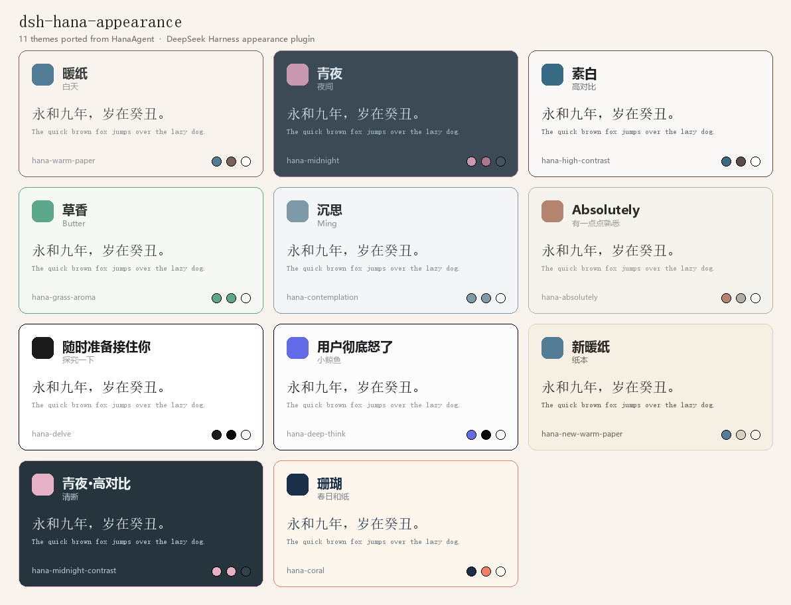

# dsh-hana-appearance · HanaUI

把 [HanaAgent（openhanako）](https://github.com/liliMozi/openhanako) 的外观系统移植成 **DeepSeek Harness** 的客户端插件：
11 套主题、阅读字体、纸质纹理、晴天树影、Windows 应用图标，以及一个和原版布局一致的中文设置页 **HanaUI**。



> 非官方社区插件，不隶属于 DeepSeek。
> 视觉语言、调色板与纸质纹理素材移植自 openhanako（Apache-2.0），详见 [NOTICE](NOTICE)；
> 本仓库的代码以 [MIT](LICENSE) 发布。

## 特性

- **11 套主题 + 自动**：暖纸、青夜、素白、草香、沉思、Absolutely、随时准备接住你、用户彻底怒了、
  新暖纸、青夜·高对比、珊瑚；「自动」跟随系统明暗。每套主题映射约 104 个 `--dsw-*` 设计 token。
- **阅读字体**：衬线（Georgia / 宋体系）、非衬线、霞鹜新致宋（按需下载 10 MB，SHA-256 校验），
  也可导入本地 `.ttf/.otf/.woff/.woff2` 自定义字体。
- **纸质纹理**：宣纸 / 棉纸 / 细颗粒三种，强度 1–5 档；原版纹理图 + 混合图层，夜间主题自动柔化。
- **排版**：正文字号 ±2、聊天宽度 640 / 720 / 800 / 不限制、工具调用图标 Emoji / SVG。
- **晴天模式**：程序化树影渲染（逐函数移植自 HanaAgent），树型可换、可保存。
- **应用图标**（仅 Windows 桌面版）：兰 / 经典 / 梅 / Bot 四套内置图标，也可以**上传自己的 PNG / JPG / ICO**
  （浏览器里裁成正方形并生成 16–256 多尺寸 ICO）；点一下即可改写桌面、开始菜单、任务栏固定快捷方式，
  并实时刷新任务栏缩略图与 Alt+Tab 窗口图标；支持更换、移除和「恢复默认」。
- **设置页**：**设置 → 通用 → HanaUI**，中/繁/日/韩/英跟随 DSH 语言设置。
- **持久化**：`$DSH_HOME/hana-appearance-state.json` 文件层 + localStorage + 启动 cookie 种子。
  DSH Desktop 每次启动端口会变、localStorage 会清空，文件层保证主题不丢。

## 安装（DSH Desktop）

插件以 `file:` 依赖装入 DSH profile，并登记到 `dsh.profile.bundles`。

**1. 取得插件源码**

```bash
git clone https://github.com/Wiedonttalk/dsh-hana-appearance.git
# 或者下载 Releases 里的 dsh-hana-appearance-0.5.3.tgz 并解压
```

> `lib/client.js` 已随仓库提供，直接可用；修改 `src/` 后需要重新构建（见下文）。

**2. 编辑 profile**

打开 `~/.dsh/profiles/desktop/package.json`：

```json
{
  "dependencies": {
    "dsh-hana-appearance": "file:C:/path/to/dsh-hana-appearance"
  },
  "dsh": {
    "profile": {
      "bundles": ["...", "dsh-hana-appearance"]
    }
  }
}
```

`file:` 的值是插件目录（或解压后的 `.tgz`）的绝对路径，
Windows 用 `C:/...` 或 `C:\\...` 均可。

**3. 安装依赖并重启 DSH**

```bash
cd ~/.dsh/profiles/desktop
pnpm install
```

重启 DeepSeek Harness，打开 **设置 → 通用**，在设置项列表里找到 **HanaUI** 即可。

卸载：从 `dependencies` 和 `dsh.profile.bundles` 中删掉对应行，重新 `pnpm install` 并重启。

## 使用

| 设置项 | 说明 |
| --- | --- |
| 语言和地区 | 跟随 DSH 语言（可单独切换）与时区 |
| 主题 | 11 套 Hana 主题 +「自动」；选中后不会被 DSH 内置主题覆盖 |
| 字体 | 衬线 / 非衬线 / 霞鹜新致宋 / 自定义；正文字号 ±2；聊天宽度 |
| 应用图标 | 兰 / 经典 / 梅 / Bot，上传自定义图标，或恢复默认（仅 Windows 桌面版） |
| 外观 | 纸质纹理与强度、工具调用图标 |
| 晴天模式 | 开关 + 选树 |

主题皮肤是「粘性」的：只有把主题切到「自动」才会把控制权交还 DSH 内置主题。

## 从源码构建

```bash
node tools/build.mjs          # 生成 lib/client.js
node tools/test-app-icon.mjs  # 桌面图标规划逻辑（纯函数）
node tools/test-client.mjs    # 无壳冒烟测试（stub react/document/ctx）
node tools/test-sunny.mjs     # 晴天渲染器测试
```

主题数据：

- 仓库自带 `src/themes.generated.json`，**开箱即可构建**；
- 如果本机有 HanaAgent 源码 checkout（`refs/hana-src` 或环境变量 `HANA_SRC` 指向仓库根目录），
  `tools/build.mjs` 会从 `desktop/src/themes/*.css` 重新解析并刷新该 JSON。

渲染主题预览图（需要 Pillow）：

```bash
python tools/make-preview.py  # → docs/themes.png
```

## 目录结构

```
src/client.template.js   浏览器半（lazy-CJS，require('react')），构建时注入主题与 CSS
src/page.css             HanaUI 设置页样式
src/themes.generated.json 主题 token 快照（由 HanaAgent 主题 CSS 生成）
lib/index.js             宿主半：状态文件读写、字体下载 routes
lib/app-icon.js          宿主半：Windows 快捷方式/窗口图标同步（见 NOTICE 的 MIT 移植声明）
lib/client.js            构建产物（已提交，可直接安装）
lib/assets/              纸质纹理 PNG
cordis.patch.yml         profile 补丁：把插件 loader 行插入 profile roster
tools/                   构建与冒烟测试脚本
```

## 已知限制

- 只在 Windows 上的 DSH Desktop 实测过，Web / CLI 形态未验证。
- DSH 部分组件若绕过 alias token 直接使用内置色，可能局部颜色不统一，需要按截图补 token。
- 应用图标同步只在 Windows 桌面版生效；Web / CLI 形态下该分区显示为不可用。
- 和别的「桌面图标跟随皮肤」类插件（例如皮肤管理器）会抢同一批快捷方式，建议二选一；
  HanaUI 恢复默认时会跳过已被其它工具删掉的图标文件，回落到程序自带图标。
- 桌面启动画面未实现（相关实验代码已移除）。

## 作者与协作

- [Wiedonttalk](https://github.com/Wiedonttalk) —— 项目发起、需求与验收，把 HanaAgent 外观的每个细节对到位。
- **DeepSeek Harness（deepseek-flash 编码代理，AI）** —— 代码实现：插件架构、11 套主题的 token 映射、
  settings 页移植、晴天树影渲染、构建与冒烟测试；本仓库的提交历史也是在 DSH 会话里整理并推送的。

> GitHub 右侧的 Contributors 只统计绑定了 GitHub 账号的提交作者，AI 助手没有账号，
> 因此不会出现在那里，所以单独在这里署名。

## 致谢与许可

- 设计语言、主题调色板、设置页布局、纸质纹理素材、晴天模式算法来自
  [liliMozi/openhanako](https://github.com/liliMozi/openhanako)（Apache-2.0），见 [NOTICE](NOTICE)。
- 可选字体「霞鹜新致宋」来自 [lxgw/LxgwNeoZhiSong](https://github.com/lxgw/LxgwNeoZhiSong)（SIL OFL 1.1），
  运行时从上游 release 下载并校验，不随本仓库分发。
- **桌面图标同步机制**移植自 [@smalltailqwq/dsh-client-ui-skin-deep-whale-manager](https://github.com/Small-tailqwq/dsh-deep-whale)（MIT），
  见 [NOTICE](NOTICE) 与 `licenses/dsh-deep-whale-manager-MIT.txt`。
- 本仓库代码：[MIT](LICENSE)。
